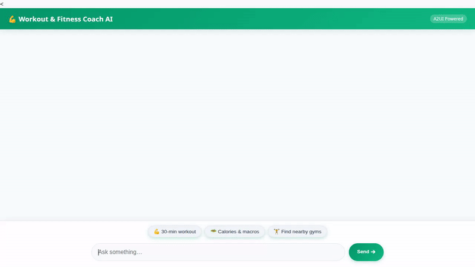

# Workout & Fitness Coach AI

> An intelligent, personalized workout and nutrition coach agent built with the Google Agent Development Kit (ADK), Vertex AI, A2UI, and Google Cloud services.



---

## 🌟 Overview

**Workout & Fitness Coach AI** provides fitness enthusiasts with personalized exercise routines, real-time nutrition info, calorie burn calculations, and location-based gym discovery. It features persistent memory recall for safety and allergies, structured card rendering via A2UI, and dynamic AI visual generation.

---

## 🛠️ Implemented Features & Google Cloud Services

The capabilities below are fully implemented and wired up in this repository:

### 1. 🤖 Agent Engine & ADK Framework
* **Framework:** Google Agent Development Kit (`google-adk`) running on Vertex AI Agent Engine.
* **Core Model:** `gemini-2.5-flash` with Vertex AI integration and HTTP retry handling.
* **Agent Engine Sandbox:** `AgentEngineSandboxCodeExecutor` for executing python calculations safely in a cloud sandbox.

### 2. 🧠 Persistent Memory Bank
* **Preload Memory Tool:** `PreloadMemoryTool` automatically retrieves user history before answering.
* **Allergy & Goal Safety:** Remembers user allergies (e.g., peanuts, gluten, lactose), dietary restrictions, and fitness goals across sessions.
* **Auto-Session Storage:** `after_agent_callback` persists completed conversation sessions into memory.

### 3. 🗄️ Google Cloud Firestore Exercise Catalog
* **Database Collection:** Connected to Firestore (`exercises` collection).
* **Catalog Lookup (`get_exercise_details`):** Retrieves exercise instructions, target muscle groups, difficulty, and set/rep recommendations.
* **Category Listing (`list_exercises`):** Filters routines by category (e.g., *Calisthenics*, *Strength*, *Core*).
* **Catalog Management (`add_exercise`):** Allows adding new exercises directly into Firestore.

### 4. 🪣 Google Cloud Storage (GCS)
* **Public Asset Bucket:** Uploads SVG cards, generated images, and video assets to Cloud Storage.
* **Public URLs:** Serves assets via direct HTTPS links (`https://storage.googleapis.com/...`).

### 5. 🎨 Vertex AI Image & Video Generation
* **AI Image Generation (`generate_domain_image`):** Uses `gemini-3.1-flash-lite-image` in global region to produce fitness meal and exercise imagery.
* **AI Video Generation (`generate_domain_video`):** Uses `gemini-omni-flash-preview` in global region to create short exercise demo videos.
* **Artifact Panel Integration:** Saves generated binaries via `tool_context.save_artifact` for immediate presentation in the ADK Playground.

### 6. 🗺️ Google Maps & Places APIs
* **Geocoding API (`geocode_address`):** Converts addresses into precise geographic coordinates (latitude & longitude).
* **Places API New (`find_nearby_places`):** Locates nearby gyms, fitness studios, and parks within a specified radius.

### 7. 🥗 Real-Time Nutrition API
* **Open Food Facts API (`fetch_food_nutrition_info`):** Searches real-time food database to fetch calories, protein, carbs, and fat content per 100g.

### 8. 📐 Workout & Macro Calculator
* **Metrics Engine (`calculate_workout_metrics`):** Computes MET-based calorie burn and recommended daily macro splits based on user weight and fitness goals (*fat_loss*, *muscle_gain*, *maintenance*).

### 9. 🎨 A2UI Rich Interface & Custom Chat Frontend
* **A2UI Schema Manager (v0.8 Basic Catalog):** Renders structured Card, Column, Row, Text, and Image components.
* **FastAPI A2A Proxy (`frontend/main.py`):** Same-origin proxy forwarding requests over the A2A protocol.
* **Rebranded Frontend (`frontend/static/index.html`):** High-energy Fitness Emerald theme (`#059669`), user/coach dialogue layout, interactive prompt chips, and a 3-dot pulse animated typing indicator.

---

## 📋 Project Requirements & Setup

### Prerequisites
* Python 3.10+
* Google Cloud SDK (`gcloud`) authenticated with a project containing Vertex AI, Firestore, and Cloud Storage.
* `uv` package manager (`pip install uv`)

### Environment Setup
Create a `.env` file in the root directory:

```bash
GOOGLE_GENAI_USE_VERTEXAI=true
GOOGLE_CLOUD_PROJECT=<your-gcp-project-id>
GOOGLE_CLOUD_LOCATION=us-east1
GOOGLE_MAPS_API_KEY=<your-google-maps-api-key>
```

---

## 🚀 Running Locally

### 1. Install Dependencies
```bash
uv sync
```

### 2. Start the Frontend Web Application
Navigate to the `frontend/` directory and run the FastAPI server:

```bash
cd frontend
export AGENT_ENGINE_RESOURCE_NAME="projects/<project-number>/locations/us-east1/reasoningEngines/<agent-engine-id>"
export AGENT_DIRECTORY="app"
export PORT=8080
python main.py
```

Open a web browser and navigate to `http://localhost:8080` to interact with the agent.

---

## ☁️ Deployment

### Deploying the Agent Engine Backend
Deploy the agent backend to Agent Runtime using `agents-cli`:

```bash
uv run agents-cli deploy \
  --project <your-gcp-project-id> \
  --no-confirm-project \
  --update-env-vars GOOGLE_MAPS_API_KEY=<your-api-key>
```

### Deploying the Frontend to Cloud Run
Deploy the FastAPI chat proxy frontend to Google Cloud Run:

```bash
cd frontend
gcloud run deploy fitness-coach-frontend \
  --source . \
  --region us-east1 \
  --allow-unauthenticated \
  --set-env-vars AGENT_ENGINE_RESOURCE_NAME="projects/<project-number>/locations/us-east1/reasoningEngines/<agent-engine-id>",AGENT_DIRECTORY="app"
```
